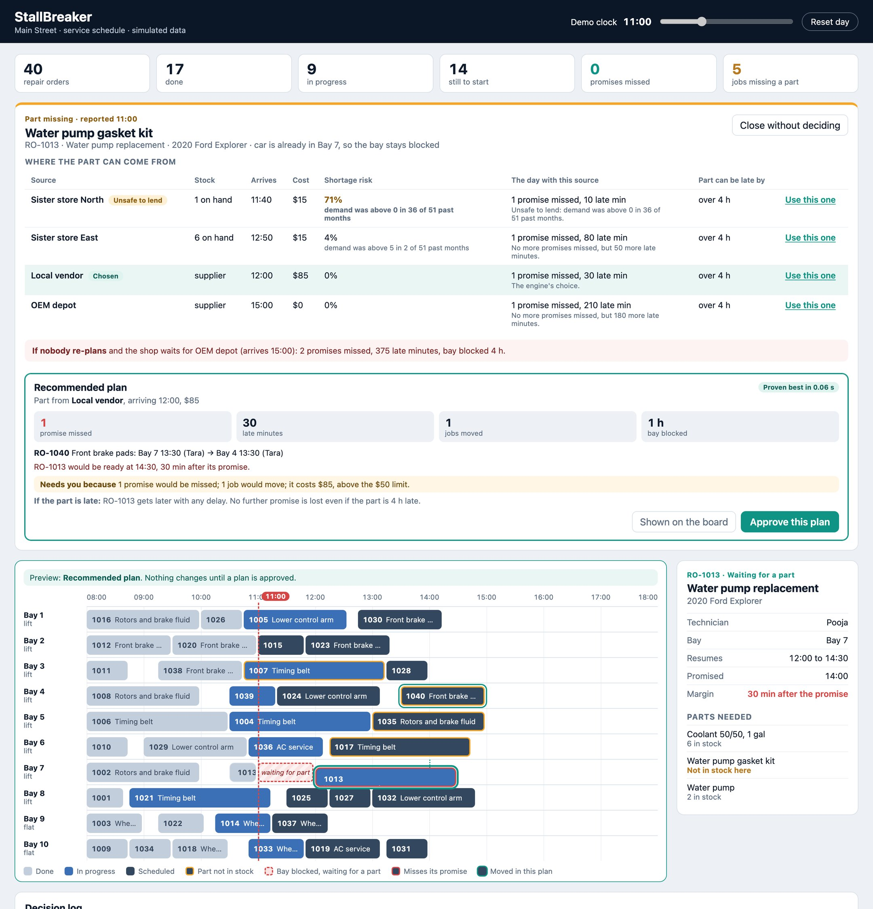
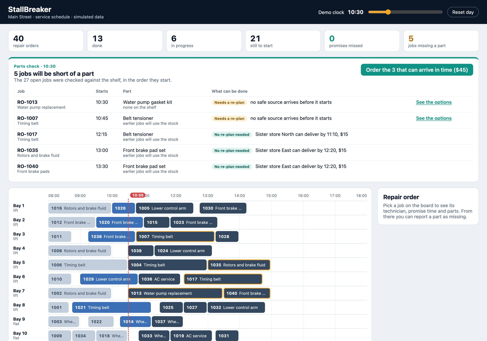
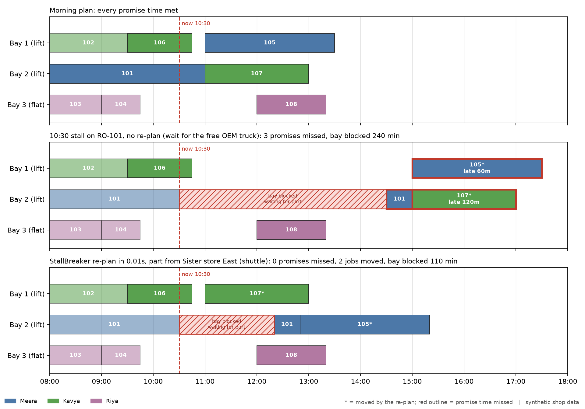

# StallBreaker

A re-planner for a car service shop when a part goes missing mid-repair. The car is half
dismantled on the lift, so the bay is blocked. StallBreaker decides **where the part comes
from** and **how the rest of the day is re-planned** in one optimisation, then shows the
service manager a before/after plan to approve.

Built for Tekion's Tek Qubit hackathon (use case: Service Parts Shortage Resolver Agent).

**Status:** a working engine with benchmarks, and a web app on top of it that runs one
simulated day end to end. All shop data is simulated; part demand history is real.
Not connected to any dealer system, and no LLM is connected yet.



## What the app does

It shows one day at a dealership (40 repair orders, 10 technicians, 10 bays, two sister
stores, a vendor and an OEM depot) on a schedule board.

- **Parts check.** The shelf stock is handed out to the open jobs in the order they start.
  Every job that will run short is listed, with whether a safe source can deliver before the
  job starts. One button orders those parts without touching the schedule.
- **Report a part missing.** Pick any open job and mark one of its parts missing. The app
  lists every source with its stock, arrival time, cost and shortage risk, and marks a
  sister store as unsafe when lending would leave it short.
- **Why not the other sources.** For every source the app shows what the day would look
  like with it (a real re-plan, not an estimate) and one sentence on why the engine did not
  choose it: unsafe to lend, more promises missed, more waiting, or higher cost.
- **How late the part can be.** Every plan and every source says how late the part can
  arrive before another customer's promise is lost, so a cheap source with no slack is
  visible next to a dearer one with hours of it.
- **Plans, with a preview.** The engine offers the plan with the fewest missed promises and,
  when it differs, the plan that moves the fewest jobs. The board previews the selected plan:
  the blocked bay is hatched and moved jobs are outlined. You can force a different source
  to see what it costs.
- **Says why it needs you.** Each plan lists what it trades off (a missed promise, a moved
  job, a cost above the spending limit, a source that is unsafe to lend from) or says that
  nothing is traded off.
- **Approve once.** The approved plan becomes the live schedule. The decision goes into a
  log with a draft message for any customer whose promise time is missed.
- **A part runs late.** For a part already on its way, a slider shows at once whether the
  plan can absorb the new arrival time or needs a re-plan.
- **Nothing is lost on refresh.** Every change is saved, including a stall that is still
  waiting for a decision.



## Run the app

```bash
uv venv --python 3.12 .venv
uv pip install --python .venv/bin/python -r requirements.txt

# terminal 1: the API (creates and seeds the database on first run)
.venv/bin/python -m uvicorn backend.app:app --port 8000

# terminal 2: the web app, then open http://localhost:5173
cd frontend && npm install && npm run dev
```

Start the API first. "Reset day" in the app rebuilds the same day every time.

## How it works

**The engine** (`shopcore.py`, Google OR-Tools CP-SAT)

- Every repair order needs one technician with the right skill and one bay of the right
  kind for its whole duration.
- A job stalled in progress keeps its bay but frees its technician until the part arrives.
  A job that has not started simply cannot begin before its part arrives.
- Where the part comes from is a decision variable in the same model as the schedule, so a
  slower, cheaper source wins whenever the schedule cannot use a faster one.
- Goals are solved in strict order, and the order is a setting. The default is fewest missed
  promise times, least lateness, lowest sourcing cost, fewest moved jobs.
- Work already in progress is never moved. Earlier stalled jobs stay pinned and their bays
  stay blocked when a later stall is planned.
- A separate checker (`validate`) re-verifies every plan: no double-booked technician or
  bay, right skills, work resumes only after the part arrives. If the solver cannot prove a
  plan is the best one within its time limit, the plan is flagged, not hidden.

The model follows the pattern of Google's flexible job-shop example (optional intervals,
exactly-one alternative, no-overlap).

**Shortage risk** (`backend/risk.py`)

Each part is tied to one real series from the Monash Car Parts dataset: 51 months of
monthly sales of one car part. The risk of lending is the share of those months in which
demand was higher than what the lending store would have left. A store above 30% is marked
unsafe and is not chosen unless a manager forces it. This is a simple frequency that anyone
can check, not a forecast model.

**The LLM** is not connected. Its planned job is narrow: explain the chosen plan in plain
words and draft customer messages. Messages use a fixed template for now and are labelled
as such. The LLM will never choose the plan.

## Project layout

| Path | Purpose |
|---|---|
| `shopcore.py` | The engine: CP-SAT re-planner, two baseline schedulers, plan checker, metrics |
| `shopgen.py`, `shopviz.py` | Seeded generator of simulated days; before/after chart |
| `backend/` | FastAPI app and SQLite database: seed data, stock lookup, shortage risk, parts check, stall flow |
| `frontend/` | React app (Vite, TypeScript): schedule board, parts check, stall card, decision log |
| `experiments/` | Sample day, 200-stall benchmark, scale check, forecasting baseline, with outputs in `out/` |
| `tests/` | 39 checks: 9 on the engine, 30 on the API |
| `data/` | Monash Car Parts dataset (CC BY 4.0) |

## Tests and experiments

```bash
.venv/bin/python -m pytest -q                      # 39 checks
.venv/bin/python experiments/toy.py                # 8 jobs, 3 bays, one missing part
.venv/bin/python experiments/eval.py 200           # 200 seeded stalls, six methods
.venv/bin/python experiments/scale.py 20           # re-plan time on 12 to 60-job days
.venv/bin/python experiments/monash_baseline.py    # forecasting baseline on real data
```



## Results

### 200 seeded stalls on the simulator

12 repair orders, 4 technicians, 4 bays per day; one missing part; 4 candidate sources.
Averages per stall.

| Method | Promises missed | Late minutes | Bay blocked (min) | Jobs moved | Sourcing cost ($) | Max solve (s) |
|---|---|---|---|---|---|---|
| wait, cheapest source | 1.74 | 186.4 | 242.2 | 0.95 | 0.0 | 0.00 |
| wait, fastest source | 0.18 | 5.6 | 57.4 | 0.68 | 64.9 | 0.00 |
| rule dispatch, fastest source | 0.15 | 5.1 | 58.9 | 1.06 | 64.9 | 0.00 |
| solver, cheapest source fixed | 0.96 | 112.3 | 242.7 | 0.81 | 0.0 | 0.10 |
| solver, fastest source fixed | 0.12 | 4.2 | 59.9 | 0.53 | 64.9 | 0.09 |
| StallBreaker (joint) | 0.12 | 4.2 | 78.2 | 0.57 | 41.9 | 0.09 |

- Morning plans with a missed promise before any stall: 4 of 200.
- Joint solves proven optimal within the time cap: 200 of 200.
- Joint solver picked the fastest safe source in 136 of 200 stalls, the cheapest safe source in 12, and something in between in 52.
- Negative controls (no stall, plan must stay untouched): 200 of 200 passed.
- Every plan from every method passed the independent rule checker (validate).

Reading: picking a fast source does most of the work. Choosing source and schedule
together keeps the same number of promises as "fastest source first" while spending
about a third less on sourcing.

### Forecasting baseline on real car-parts demand

Before using the Monash Car Parts dataset (2,674 real monthly series) to judge whether a
store can safely lend a part, we reproduced the published forecasting baseline on it.

| Model | MASE, rounded to whole units (Monash setup) | Published (Monash) | MASE, not rounded |
|---|---|---|---|
| Zero forecast | 0.746 |  | 0.746 |
| ADIDA | 0.830 |  | 1.021 |
| IMAPA | 0.834 |  | 1.019 |
| TSB | 0.881 |  | 1.045 |
| SES (optimised alpha only) | 0.887 |  | 1.046 |
| SES (optimised alpha and start level, as in R) | 0.895 | 0.897 | 1.095 |
| HistoricAverage | 0.909 |  | 1.126 |
| CrostonOptimized | 1.071 |  | 1.330 |
| CrostonSBA | 1.129 |  | 1.361 |
| Naive | 1.137 |  | 1.137 |
| CrostonClassic | 1.160 |  | 1.395 |

Simple exponential smoothing reproduces the published number (0.895 against 0.897).
A forecast of zero for every part beats every model on this metric, because three
quarters of all months have no demand. So this metric cannot decide whether lending a
part is safe, which is why the app uses a shortage-risk frequency instead.

### Scale check

One stall per day on larger simulated shops, 20 days per size, solver capped at 5 seconds.

| Jobs | Technicians | Bays | Days | Median re-plan (s) | Slowest (s) | Proven optimal | Missed promises: solver / rule dispatch |
|---|---|---|---|---|---|---|---|
| 12 | 4 | 4 | 20 | 0.01 | 0.04 | 20 of 20 | 4 / 6 |
| 24 | 7 | 7 | 20 | 0.03 | 0.04 | 20 of 20 | 8 / 10 |
| 40 | 12 | 12 | 20 | 0.05 | 0.11 | 20 of 20 | 2 / 2 |
| 60 | 18 | 18 | 20 | 0.14 | 0.49 | 20 of 20 | 0 / 0 |

These shops are lightly loaded (few promises are at risk), and the morning plan comes from the
dispatch rule. Times were measured on one laptop and will vary from run to run.

## Limits

- The shop is simulated. No public dataset of dealer repair orders, bays or multi-store
  stock exists, so the numbers compare methods; they do not predict dealer savings.
- The measured gain is modest: on the benchmark a fast source does most of the work, and
  choosing source and schedule together mainly lowers sourcing cost. It also leaves the bay
  blocked about 18 minutes longer on average, never at the cost of a promise.
- Prices, travel times and stock levels are invented. Only part demand history is real.
- Source arrival times are single values, not ranges. A late part can be re-timed, but it
  keeps its original source.
- The demo day is not very busy, so most stalls move only one or two jobs.
- The parts check runs on the rest of today's jobs. In a dealership it would run every
  night for the next day.
- No LLM is connected, and nothing is deployed: the app runs on a laptop.

## Next

An LLM step for plan explanations and customer messages, busier 40 to 60-job days, a
results page inside the app, deployment, and a stockout-risk model in place of the simple
frequency rule. Each has a spec in [docs/specs](docs/specs/README.md).

## Contributing

Every feature has a spec with numbered rules and the tests that prove them, in
[docs/specs](docs/specs/README.md). New work is spec first, failing test second, code third:
see [CONTRIBUTING.md](CONTRIBUTING.md).

## Sources

- Google OR-Tools flexible job-shop example (Apache-2.0): https://github.com/google/or-tools/blob/stable/examples/python/flexible_job_shop_sat.py
- Monash Car Parts dataset (CC BY 4.0), included in `data/`: https://zenodo.org/records/4656021
- Monash evaluation script: https://github.com/rakshitha123/TSForecasting/blob/master/experiments/fixed_horizon.R
- Godahewa et al., Monash Time Series Forecasting Archive: https://arxiv.org/abs/2105.06643
